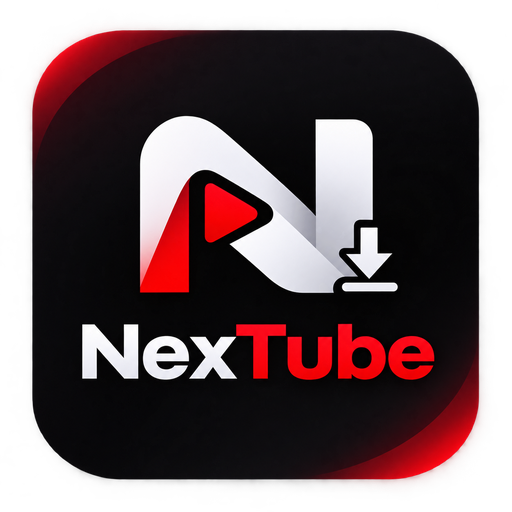
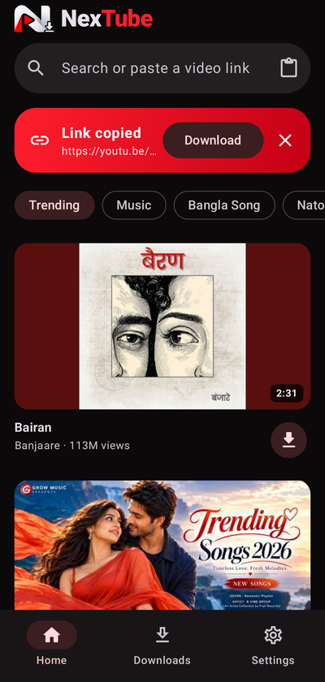
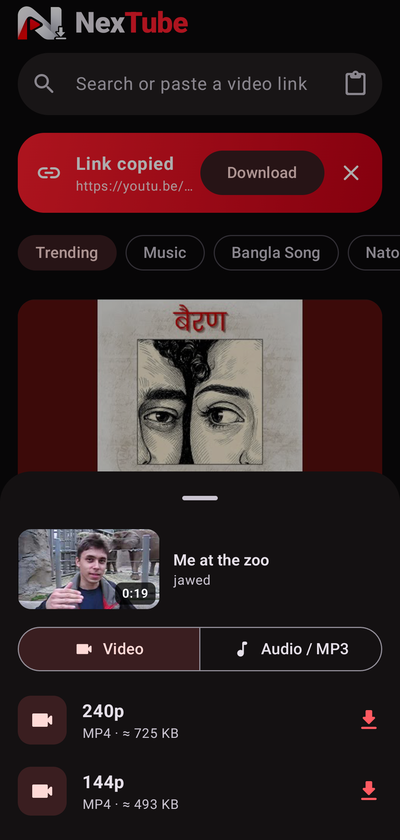
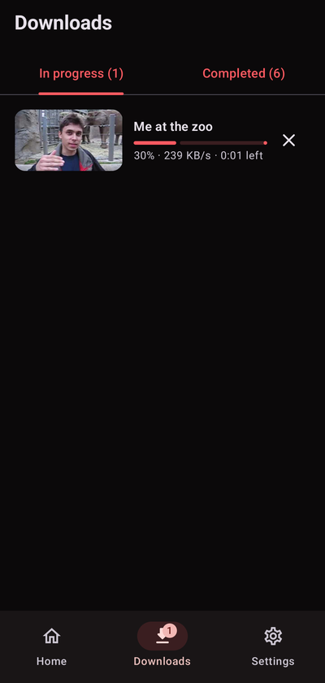
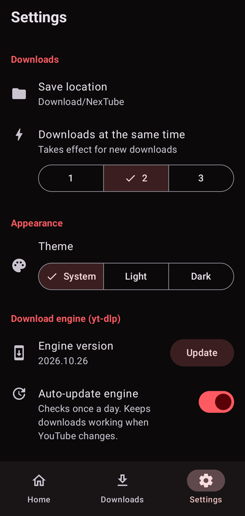

<div align="center">



# NexTube

**A fast, open-source video downloader for Android. Runs entirely on your phone. No server, no ads, no tracking.**

[](https://github.com/mehefujali/nex-tube/actions/workflows/build.yml)
[](https://github.com/mehefujali/nex-tube/releases)
[](LICENSE)
[](https://github.com/sponsors/mehefujali)


[Download APK](https://github.com/mehefujali/nex-tube/releases/latest) ·
[Sponsor](https://github.com/sponsors/mehefujali) ·
[Report a bug](https://github.com/mehefujali/nex-tube/issues/new?template=bug_report.yml) ·
[Request a feature](https://github.com/mehefujali/nex-tube/issues/new?template=feature_request.yml)

</div>

---

<p align="center">
  
  
  
  
</p>

## ✨ Features

- 🔎 **Search & browse:** search YouTube or tap a category (Trending, Music, Bangla Song, Natok, Cricket…)
- 📋 **Smart paste:** copy a link and NexTube offers to download it as soon as you open the app
- 📤 **Share to download:** tap *Share → NexTube* in the YouTube app or any browser
- 🎞️ **Every quality:** 144p up to 4K/8K MP4, with the approximate size shown before you download
- ▶️ **In-app preview player:** preview videos inline (ad-free via Media3 ExoPlayer) before downloading
- 📑 **Playlist downloads:** paste or share a playlist link, pick the videos and quality, and queue them all at once
- 🎵 **Audio:** MP3 320/128 kbps (with cover art) or original M4A
- ⚡ **Fast:** video info in ~6 s on a mid-range phone, parallel fragment downloads
- 📊 **Live progress:** percentage, speed and time left in the app and in the notification
- 🔁 **Background queue:** 1–3 downloads at once, cancel and retry, survives leaving the app
- 🔄 **Self-updating engine:** yt-dlp updates itself daily, so downloads keep working when YouTube changes
- ⬆️ **In-app updates:** new versions arrive straight from GitHub Releases with an update popup, no server needed
- 🌗 **Material 3:** light, dark and system themes
- 🔒 **Private:** no account, no analytics, no server. Files are saved to `Download/NexTube`

## 📥 Install

1. Open the [latest release](https://github.com/mehefujali/nex-tube/releases/latest)
2. Download the APK for your phone:

   | APK | Use it for |
   |---|---|
   | `app-arm64-v8a-release.apk` | Almost all phones from the last ~7 years (**pick this if unsure**) |
   | `app-armeabi-v7a-release.apk` | Older 32-bit phones |
   | `app-universal-release.apk` | Any device (bigger download) |

3. Allow *Install unknown apps* for your browser or file manager when Android asks

> NexTube is not on Google Play, because Play doesn't allow YouTube downloaders.

## 🛠️ Build from source

Requirements: **Android Studio** (or JDK 17+) and **Android SDK 36**.

```bash
git clone https://github.com/mehefujali/nex-tube.git
cd nex-tube
./gradlew assembleDebug          # Windows: gradlew.bat assembleDebug
```

APKs are written to `app/build/outputs/apk/`. Release builds (`./gradlew assembleRelease`) are signed with
your key if `keystore.properties` exists (see [CONTRIBUTING.md](CONTRIBUTING.md#release-signing)), and with the
debug key otherwise.

## 🧩 How it works

```
app/src/main/java/com/nextube/app/
├── NexTubeApp.kt             starts the engine, daily yt-dlp update
├── core/
│   ├── Updater.kt            in-app updates from update.json + GitHub Releases
│   └── YtDlp.kt              search, video info, quality list, download (yt-dlp + ffmpeg on device)
├── data/                     models, download history (JSON), settings, MediaStore saver
├── service/DownloadService   foreground download queue and notifications
└── ui/                       Jetpack Compose: Home, quality sheet, Downloads, Settings
```

- **[yt-dlp](https://github.com/yt-dlp/yt-dlp)** and **ffmpeg** run inside the app through
  **[youtubedl-android](https://github.com/JunkFood02/youtubedl-android)**, which bundles Python.
- Video info uses YouTube's `visionos` client, which needs no JavaScript challenge (~6 s instead of ~20 s).
  If it ever stops working, NexTube falls back to yt-dlp's default clients automatically.
- Progress comes from a custom `--progress-template`, which is parsed and combined across the video and audio streams.

## 💖 Support NexTube

NexTube is 100% free, open-source, and has no ads or tracking. If you find it useful, consider supporting development:

- **GitHub Sponsors (Global):** [github.com/sponsors/mehefujali](https://github.com/sponsors/mehefujali)
- **UPI (India):** `nextube@ybl`

## 🤝 Contributing

Contributions are very welcome! Read [CONTRIBUTING.md](CONTRIBUTING.md) and our
[Code of Conduct](CODE_OF_CONDUCT.md). Good first steps:

- Look for issues labelled [`good first issue`](https://github.com/mehefujali/nex-tube/labels/good%20first%20issue)
- Translate the app (strings are in `app/src/main/res/values/strings.xml`)
- Report sites or videos that fail to download

## ⚠️ Disclaimer

NexTube is a tool for downloading media **you own or have permission to save**, such as your own uploads,
Creative Commons and public-domain content, or videos the creator allows you to download.
Downloading copyrighted material without permission may violate the law in your country and
the terms of service of the website. You are responsible for how you use this app.
NexTube is not affiliated with, endorsed by, or connected to YouTube or Google.

## 📄 License

NexTube is free software, released under the **[GNU General Public License v3.0](LICENSE)**.

## 🙏 Credits

- [yt-dlp](https://github.com/yt-dlp/yt-dlp): the download engine
- [youtubedl-android](https://github.com/JunkFood02/youtubedl-android): yt-dlp, Python and ffmpeg for Android (GPL-3.0)
- [FFmpeg](https://ffmpeg.org): merging and audio conversion
- [AndroidX Media3](https://developer.android.com/media/media3): in-app preview player
- [Coil](https://coil-kt.github.io/coil/): image loading
